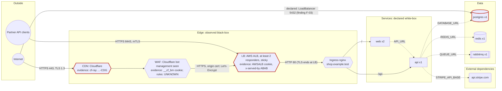

# Topology mapping: who talks to whom

The deliverable of this step is one diagram that answers three questions: **what enters
from outside, through what; what talks to what inside; and where the data sits.** Every
edge on it carries its evidence, and declared facts are kept apart from inferences.

## The reference chain

Real systems are a subset of this chain, in this order. Each hop is a place where TLS
may terminate, where a request may be filtered, and where the client IP may be lost.

```
client -> DNS -> CDN / edge -> WAF -> L4/L7 load balancer -> ingress / API gateway
       -> service -> { database, cache, queue, object storage } and external SaaS
```

Concrete example (the `fixtures/k8s` system): `Outside -> Ingress shop (HTTP, no TLS)
-> svc web -> web x2`, and in parallel `Outside -> svc postgres (LoadBalancer :5432)
-> postgres x1`: a database that declares its own entry point, skipping the ingress.

**Declared is not reachable.** The generator's `Outside` node means "a file asks for
an entry point outside the cluster or the host". Whether the internet can reach it
(internal load balancer, source ranges, pending address, cloud firewall) is not in
the manifest: write `declared` on such an edge, and `observed from <where>` only
after an authorized probe or the owner's confirmation.

## Two sources, two kinds of edges

| Source | Gives | Edge style | Trust |
|---|---|---|---|
| Black-box (`collect-headers.sh`, `tls-and-dns.sh`, nmap) | The edge layers actually deployed: CDN, WAF, LB, proxy, open ports | solid, labelled with the header or port that proves it | Observed, but only the outer layers |
| White-box declared (Ingress, Service, `ports:`, security groups) | The intended routing and exposure | solid | Declared: true only if the manifests are what is deployed, and says nothing about who can reach it |
| White-box inferred (a Service name in an env var, a URL in a ConfigMap, Compose `depends_on`) | Service-to-service and SaaS dependencies; `depends_on` is startup order, not traffic | dashed | Inferred: a hint, confirm with the team or with traffic data |

A mismatch between the two sources is a finding in itself. Made-up example: the
manifests declare an Ingress with TLS, the black-box run shows port 5432 open on the
same IP. Either the manifests are not what runs, or something outside them (a console
click, another repository) opened the port. Both are worth a line in the report.

## Step 1: generate the white-box skeleton

Every output goes to a fresh scratch directory **outside** the audited checkout. The
`>` redirection is opened by the host shell before Docker starts, so the read-only
mount does not protect it: written into the checkout, an existing file would be
truncated, a symlink shipped by the repository would be followed, and rendered Secrets
would sit next to the code.

```bash
umask 077; OUT=$(mktemp -d); R=$(cd path/to/repo && pwd)   # OUT is mode 0700, outside R
docker run --rm --network none -v "$R":/work:ro -v <skill-dir>/scripts:/s:ro python:3.12-slim \
  python -I /s/topology-from-manifests.py /work/deploy --markdown > "$OUT/topology.md"
```

Helm and Kustomize must be rendered first, into a scratch directory, with the values
file or overlay that production uses (ask which one; a guess makes the map fiction):

```bash
mkdir "$OUT/rendered"                      # same $OUT and $R as above
docker run --rm --network none -v "$R":/work:ro -w /work alpine/helm:4.3.2 \
  template myrelease ./chart -f values-prod.yaml > "$OUT/rendered/chart.yaml"
docker run --rm --network none -v "$R":/work:ro registry.k8s.io/kustomize/kustomize:v5.8.1 \
  build /work/overlays/prod > "$OUT/rendered/kustomize.yaml"
docker run --rm --network none -v "$OUT/rendered":/work:ro -v <skill-dir>/scripts:/s:ro \
  python:3.12-slim python -I /s/topology-from-manifests.py /work --markdown > "$OUT/topology.md"
```

Both were run on a throwaway chart and overlay (a `namePrefix: prod-` overlay rendered
`prod-hp`). `--network none` matters: a kustomization can name a remote base and a chart a remote
dependency, so a render would otherwise contact a host chosen by the repository. With
the network off such a render fails (seen with a remote `resources:` URL): stop, ask
for a vendored copy, and count the failure as a hole in coverage, never as a reason
to switch the network on. Rendered output can contain Secrets: it stays in `$OUT`, is
never copied into the checkout, and is deleted (`rm -rf "$OUT"`) or handed over at the end. A file the parser cannot read is listed on stderr as `skipped`, never silently
dropped: a skipped file is a hole in the map, say so.

What the generator draws, and from which field:

| Edge | Read from | Example in `fixtures/` |
|---|---|---|
| `internet --> Ingress` / `HTTPRoute` | `kind: Ingress`, `spec.rules[].host`, labelled `HTTP (no tls declared)` or `HTTPS (tls declared)`: what the file declares, not what is served (controller default certificate, upstream termination). `HTTPRoute`: `protocol UNKNOWN (Gateway listener not read)` | `internet -->|"HTTP (no tls declared)"| ing_shop_shop` |
| `Ingress --> Service` | `spec.rules[].http.paths[].backend.service.name` | `ing_shop_shop -->|"/api"| svc_shop_api` |
| `internet --> Service` | `spec.type: LoadBalancer` or `NodePort`; ` (restricted?)` is appended when an internal-LB annotation or `loadBalancerSourceRanges` is present | `internet -->|"LoadBalancer 5432"| svc_shop_postgres` |
| `Service --> workload` | `spec.selector` matched against pod template labels, same namespace | `svc_shop_web -->|"selector"| wl_shop_web` |
| `workload -.-> Service` | an env value, arg or ConfigMap entry naming the Service as a host | `wl_shop_api -.->|"DATABASE_URL"| svc_shop_postgres` |
| `workload -.-> external` | a URL or bare FQDN in an env value that is not a cluster name | `wl_shop_api -.->|"STRIPE_API_BASE"| ext_api_stripe_com` |
| `internet --> compose service` | `ports:` published on a non-loopback address | `internet -->|"0.0.0.0:5432"| cmp_compose_db` |
| `service -.-> service` (Compose) | `depends_on`: startup order, drawn dashed | `cmp_compose_proxy -.->|"depends_on (startup order)"| cmp_compose_app` |

The node id `internet` is displayed as "Outside (declared, not probed)".
Cross-namespace inference requires the qualified name (`ledger.payments` or longer), so
a Service called `api` in another namespace is not matched by accident.

## Step 2: add the black-box layers by hand

The generator knows nothing above the Ingress. Prepend what the collectors observed,
one node per layer of `layers[]` in the header report, and label each edge with its
evidence.

| Observation (JSON path) | Node to add | Edge label |
|---|---|---|
| `layers[].layer == "cdn"` | CDN node (vendor from `identifies`) | the header, e.g. `cf-ray …-CDG` |
| `layers[].layer == "waf"` | WAF node, labelled "vendor hinted; rules enforced: UNKNOWN" (a bot-management cookie proves the product, not a rule set) | the cookie name or header |
| `load_balancing.suspected` with `estimated_backends: k` | LB node, and "at least k responders (inferred)" on its outgoing edge: they can be pods, workers or caches | `x-served-by` pattern `BABA` |
| `load_balancing.affinity.sticky: true` | annotate the LB edge "sticky (cookie)" | cookie name |
| `dns.cname_chain` ending at a provider | one node per provider hop | CNAME target |
| `dns.a` with several records | "several addresses" on the first edge (round robin or anycast: not distinguishable from outside) | the addresses |
| nmap open port not explained by any manifest | a red node "unexplained listener :PORT" | the nmap line |
| `tls.certificate.issuer` differing between edge and origin | mark where TLS terminates | issuer names |

## Mermaid template

Copy, delete the zones that do not exist, keep the legend. Node shapes: circle =
outside actor, hexagon = entry point, rounded = Service or SaaS, box = workload,
cylinder = database or cache, double box = queue. Red border = reachable from outside.



Legend to keep under the diagram: solid arrow = declared or observed (say which on the
label); dashed arrow = inferred from configuration; red border = an entry point from
outside is declared or observed.

## Step 3: read the map (the checks it makes possible)

| Question | How to answer on the map | Finding when |
|---|---|---|
| What enters from outside? | List every edge leaving `Outside` | An entry point is not in the scope document, or is not a hexagon (a data node reachable directly) |
| Does every entry pass the WAF? | Follow each path from `internet` | A path reaches a service without crossing the WAF/CDN (origin bypass, extra LoadBalancer Service) |
| Where does TLS end? | Label each edge with its protocol | Clear text crosses a network boundary (LB to pods across nodes, service to database) without a mesh or TLS |
| Is the network segmented? | Look for edges that no policy would stop | A namespace has no NetworkPolicy (`T-K8S-01`): every dashed edge that does **not** exist is still permitted. With policies present, the generator does not evaluate them: read K-15 and K-16 per sensitive flow, else `UNKNOWN` |
| Which node is a single point of failure? | Nodes marked `x1` on a path every request takes | `x1` on the request path or on a datastore with no replica |
| What leaves the system? | Edges into `External dependencies` | An egress nobody can explain, or no egress control at all |
| Does the client IP survive? | Count proxies between `internet` and the service | More than one proxy and no agreed `X-Forwarded-For` / PROXY protocol handling (rate limits and logs keyed on a proxy address) |

## Known limits of the generator

- Inferred edges come from environment values only. A dependency configured in a
  mounted file, a Secret, or code is invisible. Absence of an edge is not absence of
  traffic.
- NetworkPolicies are counted per namespace, not evaluated: the generator says "no
  policy at all", it does not say whether an existing policy is too wide.
- Gateway API: only `HTTPRoute` is read. Entry points declared by `Gateway`
  listeners, `TCPRoute`, `TLSRoute` or `GRPCRoute` are missing from the map: when
  those kinds exist, add them by hand or mark the entry-point list `UNKNOWN`.
- Exposure is declared, never probed: see "Declared is not reachable" above.
- Only Kubernetes and Compose are parsed. For Terraform, read security groups, load
  balancer listeners and route tables by hand (`references/iac-checks.md`).
- The YAML reader is a standard-library subset parser. It was compared with PyYAML on
  35 real files of this repository plus the fixtures with identical results, but exotic
  YAML (complex keys, tags with semantics) is skipped with a message.
