# Linear Atlas — draw, check and watch a Linear project

Three tools, one skill: the **graph** (and its `verify` check and `serve` page),
the **watcher** `lw`, and the **MCP server** that hands the watcher to agents without
Docker. The vocabulary they check against (types, complexity, features, proofs) is
the [`linear-semantics`](../linear-semantics/SKILL.md) skill, read from
`../linear-semantics/references/semantics.json` (override with `LINEAR_SEMANTICS`
or `--semantics`). Publishing findings and following a spec are
[`linear-tracker`](../linear-tracker/SKILL.md).

## Dependency graph of a project — SVG for humans, JSON for agents

Linear stores "blocks / blocked by" between issues, and shows it nowhere as a
picture: the issue sidebar lists the relations of one issue, and the Timeline
view draws **projects**, never issues. `scripts/linear_deps.py` fills that gap
with one read of the project and two outputs:

- **for a human, a clickable SVG** (`-o deps.svg`, always written): issues in
  columns grouped in one band per project milestone, blockers on the left, an
  arrow per blocking link, and **every box a link to its issue**;
- **for an agent, a JSON graph** (`--json-out deps.json`): every issue with its
  ticket type, its direct blockers and blocked issues, every relation once, the
  cycles, and the issues with no dependency. `linear_deps.py check` then answers,
  offline, "is every issue of type X blocked by at least one issue of type Y?".
  Reason over that file instead of calling `get_issue` once per issue.



*Open `references/linear-deps-demo.svg` in a browser: the boxes are clickable.*

### Run it

```bash
export LINEAR_API_KEY=...   # see "The API key" below; never paste it in a chat
docker run --rm -e LINEAR_API_KEY -v "$PWD":/work -w /work python:3.12-slim \
  python skills/linear-atlas/scripts/linear_deps.py \
  "https://linear.app/<workspace>/project/<name>-<slugId>" -o deps.svg --json-out deps.json
```

Run it from the repository root; adjust the script path if the skill is installed
elsewhere. `-e LINEAR_API_KEY` forwards the variable without writing its value on
the command line. Python standard library only; Docker is the execution rule.

| Option | Effect |
|---|---|
| `-o FILE` | SVG file (default `deps.svg`) |
| `--json-out FILE` | also write the JSON graph (see [The JSON graph](#the-json-graph)); independent of the drawing options below |
| `--include-related` | also draw "related" links, dotted. Off by default: they order nothing |
| `--external show` | draw issues outside the project as dashed boxes. Default `drop`: the links to them are counted in a footer note |
| `--no-milestones` | flat layout: no milestone bands, no dashed separators. Default: one band per project milestone |
| `--hide-isolated` | hide issues without dependency. Default: a strip of clickable chips below the graph |
| `--no-descriptions` | do not fetch or embed description excerpts (no text in the hover preview, `description_excerpt: null` in the JSON). Use it for an SVG that will be shared: descriptions can be sensitive |
| `--from-json FILE` | no API call; read the normalized data from FILE (see below) |

### Interactive page — `linear_deps.py serve`

A local daemon that draws the same SVG in a web page with live filters. It lists the
projects the key's user belongs to (member or lead); you pick **one** project at a
time, then filter it by milestone (tick the ones to keep) and by label (any of the
ticked ones). Priority is a third filter (Urgent, High, Medium, Low, No priority), and each card
carries it as a left-to-right background tint of the priority's colour (red, orange,
yellow, blue; none: no tint), in the CLI's SVG as well. The Milestones and Priority
headings each have an "all / none" checkbox.
A filter alone would cut the context, so **keep direct neighbors** (on by default)
also draws the issues one blocking link away from the filtered ones, with only the
links that touch a filtered issue. Two more toggles hide issues without dependency and
show outside links.
Each change re-renders the SVG server side with the CLI's own renderer; the page
shows it in an iframe so the hover preview keeps working. The project is fetched
once and reused for 60 s; **Refresh** refetches it from Linear.

```bash
mkdir -p ~/.cache/linear-atlas
docker run --rm -e LINEAR_API_KEY -p 127.0.0.1:4420:4420 \
  -v "$PWD/skills/linear-atlas/scripts":/s:ro -v ~/.cache/linear-atlas:/data -w /s python:3.12-slim \
  python -B -I linear_deps.py serve --host 0.0.0.0 --port 4420 --db /data/linear.sqlite
open http://localhost:4420
```

The key never leaves the process. `--host 0.0.0.0` is for inside the container only:
the `-p 127.0.0.1:` mapping keeps the page on your machine, and the server refuses any
`Host` header other than `localhost`, `127.0.0.1` or `[::1]` with its port.
Outside Docker, plain `python3 linear_deps.py serve` binds `127.0.0.1:4420`.

#### The local cache

`serve` keeps what it reads in a SQLite file (`--db`, default `~/.cache/linear-atlas/linear.sqlite`,
or `$LINEAR_TRACKER_DB`; `--no-db` goes back to reading Linear live). The scripts are mounted `:ro`,
so in Docker the file needs its own writable volume, as above: without it the cache dies with the
container. The API key is never written to the file.

The tables follow Linear's entities and association tables: `teams`, `users`, `workflow_states`,
`projects` (+ `project_teams`, `project_members`), `milestones`, `labels`, `issues` (+ `issue_labels`),
`issue_relations`, and `sync_state` (the watermarks and the last error). `linear_store.py` returns the
same dict as the live fetch, so the renderer cannot tell the difference (checked on a 216-issue project:
identical issues, links, external issues and labels).

A project is read in full the first time you open it (**backfill**), then kept fresh by a **differential
pull** every `--sync-interval` seconds (default 60): the issues updated since a per-team watermark, archived
ones included. The watermark is the highest server `updatedAt` seen, never the local clock; the pull
re-reads five seconds before it and every write is an upsert. An issue moved out of a tracked project
leaves the graph; one moved in appears.

What a delta cannot see, and the **reconcile** that covers it (a full re-read of each tracked project every
`--full-every` pulls, default 30, and on the page's **Refresh**): `issueRelations` has no `updatedAt`
filter, so a "blocks" link added or removed without touching either issue can stay stale for up to
`--full-every` x `--sync-interval` (30 min by default); and an issue that was *deleted* (not archived)
never comes back in a delta, so only a reconcile drops it. The header shows when the project was last
pulled, and the last error if the API could not be reached (the page keeps serving the cache).

Out of scope: comments, cycles, history, webhooks, schema migrations. The file is a cache: delete it to
start over.

A project you are neither member nor lead of is not listed. Pin it with `--project
<slugId>` (the hex tail of its URL, repeatable): `serve ... --project 5842ed0c2bcd`
adds "Broker PA · Run & évolutions — courant".

### How to read the picture

- **Milestone bands.** The picture is cut into vertical bands, one per project
  milestone that has an issue in the drawing, in the milestone order of Linear
  (`sortOrder`, then target date, then name). Each band has its milestone name as a
  header and a **dashed vertical line** separates it from the next. Example
  (made up): a project with milestones "Staging" then "Production" shows every
  Staging issue on the left, a dashed line, then the Production issues. Issues with
  no milestone, and outside issues drawn with `--external show`, sit in a last band
  named "No milestone". Milestones with no issue are not drawn. The issues without
  dependency (the chip strip below the graph) are grouped by band too, so the
  reading stays the same top to bottom. A link between two bands is drawn across
  them as usual; when the blocker is in a later milestone than the issue it blocks,
  the arrow simply points left (it is a normal link, not a cycle). A project whose
  issues have no milestone is drawn flat, and `--no-milestones` forces that.
- **Columns** come from the longest path **inside a band**: an issue sits one column
  to the right of its furthest blocker of the same band (links from another band do
  not move it). The leftmost issues of each band are what to unblock first.
- **States follow Linear's own code.** Each card's border and left strip take the
  colour of its workflow state as the team configured it in Linear (`state.color`),
  so "In Review" keeps its own green although its type is `started`. The icon next to
  the identifier mirrors Linear's: dashed circle backlog, empty circle todo,
  half-filled in progress, filled with a check done, filled with a cross canceled,
  ringed dot triage. Backlog cards also have a dashed outline; canceled titles are
  struck through. Offline data without a colour falls back to Linear's defaults per
  type (backlog `#bec2c8`, unstarted `#e2e2e2`, started `#f2c94c`, completed
  `#5e6ad2`, canceled `#95a2b3`, triage `#fc7840`).
- **A legend** under the title lists every state present, by its Linear name, with
  its icon and colour, then the other markers drawn: hatched boxes with an
  `external` chip for issues outside the project, solid arrows for "blocks", dotted
  lines for "related", dashed red for the link that closes a cycle, and the type and
  label chips. It is built from the same functions as the cards (`state_look`,
  `state_glyph`), so nothing is drawn without being explained.
- **Point at a card** and what leads to it stands out at once: its direct blockers
  and the links into it in full strength, the rest of the chain upstream (blockers
  of blockers, outside issues included when drawn) a little lighter, everything else
  faded. Downstream issues are not lit: the question is what stands in the way of
  this one. The chains are computed when the SVG is generated (a cycle ends, an issue
  is never its own blocker); the legend's last two lines show the two strengths.
- **Click a card that has links** to pin its connections: what blocks it and what it
  blocks, along the whole chain, stay lit, everything else fades, and the view moves
  and zooms out in one smooth camera move so all of them sit centred in the window
  (never magnified past 1:1, so a long chain shows small). Click it again, click the
  background or press Escape to go back where you were. A card with no link, and a
  ctrl/cmd/shift-click, still open the issue; every other card has a small arrow chip
  at its top right that opens the issue in Linear. Without scripts the whole box
  remains a plain link. The pin needs the SVG opened directly in a browser or in the
  `serve` page, like the preview.
- **Hover a card for a fifth of a second (200 ms)** to get a preview, like Linear's issue peek:
  state icon, identifier, full title, state · assignee · milestone, type and label
  chips, and the beginning of the description (about 500 characters, markdown noise
  stripped). The text is embedded **when the SVG is
  generated**: the picture never calls Linear when viewed, so it is a snapshot, and
  it holds the descriptions of the project until you regenerate it with
  `--no-descriptions`. The preview needs the SVG opened directly in a browser (a
  small inline script); where scripts are blocked (`` embedding, GitHub's file
  preview) the native tooltip (`<title>`) still shows the same facts and a shorter
  excerpt.
- **A card** shows the identifier, `↳ TT-1970` for the parent issue, the title, then
  the state name · assignee · milestone, then chips: the ticket type first (bold,
  bordered), then the other labels as `group/name` (`repo/acme-hub`). What does not
  fit ends with `…` or a `+N` chip; the **tooltip** holds everything: full title,
  state, type, assignee, milestone, parent and every label.
- A **cycle** (A blocks B blocks A) is reported on stderr and in the SVG; the link
  that closes it is drawn dashed in red. The run still succeeds: a cycle is data
  worth showing, not a failure.

### The JSON graph

Made-up sample, trimmed to two nodes and two edges
(`tests/fixtures/linear-deps-types-fail.json`, exported with `--json-out`):

```json
{
 "format": "linear-deps/1",
 "project": {"name": "Invitations lot, broken (made up)",
             "url": "https://linear.app/acme/project/invitations-0123456789ab",
             "milestones": ["Invitations"]},
 "nodes": [
  {"identifier": "INV-1", "title": "Invitation API", "url": "https://linear.app/acme/issue/INV-1",
   "external": false, "state": "started", "state_name": null, "state_color": null, "assignee": null,
   "parent": null, "milestone": null,
   "type": "Technical task", "labels": [{"name": "Technical task", "group": "Type"}], "description_excerpt": null,
   "blocked_by": [], "blocks": ["INV-3"]},
  {"identifier": "INV-4", "title": "Accept link works on staging", "url": "https://linear.app/acme/issue/INV-4",
   "external": false, "state": "unstarted", "state_name": null, "state_color": null, "assignee": null,
   "parent": null, "milestone": null,
   "type": "Proof", "labels": [{"name": "Proof", "group": "Type"}], "description_excerpt": null,
   "blocked_by": ["INV-5"], "blocks": []}
 ],
 "edges": [
  {"from": "INV-1", "to": "INV-3", "type": "blocks"},
  {"from": "INV-5", "to": "INV-4", "type": "blocks"}
 ],
 "cycles": [],
 "no_dependency": ["INV-6"]
}
```

- **`edges`**: one per relation. A `blocks` on A and the inverse "blocked by" on B
  are one edge, `from` blocks `to`. `related` and `similar` are an unordered pair
  (sorted `from`/`to`), `duplicate` keeps its direction.
- **`project.milestones`**: the project's milestone names in order (Linear's
  `sortOrder`, then target date, then name), empty milestones included. It is the
  band order of the SVG. In `--from-json` input this field is optional: when absent,
  the order is derived from the issues' milestones, sorted by name.
- **`type`**: the label of the workspace label group **Type** of
  [`../linear-semantics/references/ticket-types.md`](../linear-semantics/references/ticket-types.md); failing that, a label
  named like one of the eight types (`proof`, `technical-task`); else `null`.
- **Outside issues** linked to the project are nodes too, `"external": true`, with
  their type when Linear returned their labels, and `state`/`parent` `null`.
  The drawing drops them by default; the JSON never does.
- **`description_excerpt`**: the beginning of the description as plain text (about
  500 characters, cut on a word with `…`), or `null` with `--no-descriptions`. Enough
  to tell what an issue is about without a `get_issue` per node.
- **`cycles`**: each loop of `blocks` links, as the sorted list of its issues.
- **`no_dependency`**: project issues with no `blocks` link either way, outside
  links included. It can be shorter than the SVG's strip, which ignores dropped
  outside links.

### Checking a typing rule — `linear_deps.py check`

```bash
docker run --rm -v "$PWD":/work -w /work python:3.12-slim \
  python skills/linear-atlas/scripts/linear_deps.py check deps.json \
  --type Proof --blocked-by "Technical task,Bug"
```

Every project issue of `--type` must be blocked by at least one issue whose type is
in `--blocked-by` (repeatable or comma-separated; names compare case- and
dash-insensitively). `--open-only` skips completed and canceled issues. Output on
the same made-up fixture:

```text
FAIL     INV-4  https://linear.app/acme/issue/INV-4  [unstarted] Accept link works on staging  blocked by INV-5 (Question)
FAIL     INV-6  https://linear.app/acme/issue/INV-6  [completed] Old proof, done  no blocker
UNKNOWN  INV-7  https://linear.app/acme/issue/INV-7  [unstarted] Resend works on staging  blocked by OUT-1 (type unknown)
4 Proof issue(s) checked against Technical task / Bug: 1 ok, 2 fail, 1 unknown
```

`UNKNOWN` means no qualifying blocker was found but at least one blocker has no
readable type: open it before calling it a violation. Exit code 0 when every issue
passes, 1 otherwise. When no issue has `--type`, a note on stderr lists the types
present, so a misspelt type is not read as "all good".

### Detecting semantic inconsistencies — `linear_deps.py verify`

`verify` is a deterministic **detector**: it reads a model (a JSON file), reads a project
(an exported `deps.json` or a project URL fetched live) and prints the list of tickets
that contradict the model. It blocks nothing and is wired to nothing: the exit code is a
linter's (1 on a `FAIL`), `--exit-zero` makes it report-only, and a hook or a person
decides what to do with the list.

```bash
docker run --rm -e LINEAR_API_KEY -v "$PWD":/work -w /work python:3.12-slim \
  python skills/linear-atlas/scripts/linear_deps.py verify "<project URL>" \
  --semantics .claude/linear/semantics.json --json --exit-zero
```

`--json` prints a sorted list of `{rule, status, issue, state, title, reason}`; the same
input always gives the same bytes. Without it, one line per rule (`PASS`, `FAIL`,
`UNKNOWN`, `N/A`) then the offending issues, under a `model:` header naming the files
used. `UNKNOWN` means the export lacks the fact (a description, the team mapping), never
a violation. `--strict` also exits 1 on `UNKNOWN`; `--rule ID` runs some rules;
`--open-only` skips closed issues (not for rules about state, which look at closed ones
on purpose).

#### Three layers, and which one is yours

```text
Linear (fixed, the engine knows only this)   issue · label (name, group) · state type
                                             · project milestone · parent / sub-issue
                                             · relations blocks, related (+ duplicate, similar, ignored)
        ↑ binding   « business type = the label of group Type », « a lot = a milestone »,
        |           « Done = state type completed »
Your ontology (a JSON file you own)          types, roles, groupings, and rules in a closed vocabulary
        ↑ rules     « a Done Proof has no blocker of role change that is not Done »
Your project                                 what `verify` reads
```

Worked example. In Linear, INV-30 carries the label `Proof` of group `Type`, state type
`completed`, and is blocked by INV-12 (label `Technical task`, state `started`). The
binding turns the labels into business types (Proof, Technical task) and the role
`change` is the Technical task (a Bug has the role `problem`). The rule
`closed-requires-blockers-closed` (subject `Proof`, objects `@change`) then reads: INV-30
is Done but blocked by INV-12 still In Progress, a `FAIL`. Change the binding (group
`Kind`, values `Story`/`Check`) and the same engine judges another vocabulary: the
tests run it on one that shares nothing with the shipped file. The engine **refuses at
load** anything Linear does not offer (a relation `depends`, a grouping on `sprint`, a
state type `shipped`), so a typo never reads as « all good ».

#### `../linear-semantics/references/semantics.json` is a template, not the norm

It holds **one coherent proposal**: the eight ticket types of
[`../linear-semantics/references/ticket-types.md`](../linear-semantics/references/ticket-types.md) and the rules on them. A
project that works differently does not have to follow it: copy the file, change types,
roles, binding and rules, and point `--semantics` at the copy. Do not assume the shipped
rules apply to a project before asking its owner which ones it wants. `--rules` is for
the small case: a few extra rules, or a tweak of one, on top of whichever model is used.

The model's two blocks: `generic` (tool-agnostic: types with definition, test, roles and
required sections; relations; rules) and `binding` (Linear: label groups for the types and
attributes, templates, the milestone as the grouping, state types that count as done or
ignored). The `type` attribute is the engine's one primitive: `binding.attributes.type`
names the label group and lists the values, which must equal the type ids.

Rule kinds (the closed vocabulary; types are an id, a list, `@role` or `*`):

| Kind | Says |
|---|---|
| `closed-requires-blockers-closed` | a closed `subject` has no `objects` blocker that is not closed (ignored states do not count; a blocker outside the project is `UNKNOWN`) |
| `grouping-exists` | the project has ≥ `min` (default 1) groupings (milestones) whose name matches the regex `match`, case-insensitive |
| `grouping-contains` | each grouping (milestone) holds ≥ `min` (default 1) tickets of `subject` |
| `grouping-covers-attribute` | each grouping (milestone) holds a `subject` ticket for every value of `attribute` (default: all bound values, narrow with `values`), e.g. a Proof on Staging and on Prod |
| `grouping-name-forbids` | no grouping (milestone) name matches the regex `match`, or, with `attribute`, contains a value or an alias of that attribute (binding), e.g. a lot never named after an environment |

Any rule may carry `"severity": "warning"` (default `error`): its findings print and export as `WARN`, are counted apart, and never set the exit code, not even with `--strict`. The two environment rules of the template are warnings.
| `linked-to` | each `subject` has a `relations` link (`blocks`, `related`, `parent`, `child`) to a ticket of `object` |
| `linked-or-waived` | the same, unless the section named by `waiver.section` starts with `waiver.match` (a regex); `"waivable": false` removes the waiver |
| `blocked-by-any` / `blocked-by-all-in-grouping` | a `subject` is blocked by at least one / by every `objects` ticket of its grouping; `where` / `objects_where` (`{attribute, value}`) narrow either side, e.g. Prod Proofs blocked by the Staging Proofs of their lot |
| `attribute-cardinality` / `-required` / `-only-on` | label-group counts and where an attribute may appear |
| `team-matches-attribute` | the issue lives in the team that `binding.attributes.<attribute>.team_keys` maps the label to |
| `requires-sections` | the body has the sections its type requires (`required_sections`), the first one first |

Example (made up), a model for a team that calls things differently: types `Story`,
`Spike`, `Check`, label group `Kind`, the rule « a Spike is a sub-issue of a Story »
(`linked-to`, subject `Spike`, relations `["parent"]`, object `Story`). A Spike with no
parent comes back as `spike-under-story  ZZ-3  FAIL  no linked Story`.
`tests/fixtures/engine-model.json` is that model.

#### Reports: what is in staging, what is in prod

A model may declare `generic.reports` (grouping, subject type, attribute to split by).
The shipped template declares one: per lot (milestone) and per Environment, the
Proofs Done over the Proofs, `✔` all Done, `⧗` some open, `-` none. A Linear milestone
carries no label, so the environment is read from the Proofs, never declared on the
lot:

```text
report lot-environments  Per lot and per environment: Proofs Done / Proofs.
  Invitations                                      Staging ✔ 2/2   Prod ⧗ 0/1
  Refunds                                          Staging ⧗ 1/2   Prod - 0/0
```

(made-up lots). `--json` carries the same rows under `reports`. The report follows
`--semantics`: a model with another vocabulary (types, attribute, grouping) gets its own.

#### Writing the rules with someone — a guided session

Do not guess rules; ask in this order and write each answer as one rule:

1. *Which tickets does it constrain?* → `subject`.
2. *What must be true of them?* → pick the kind in the table.
3. *Does a closed ticket count?* Rules about state look at closed subjects on purpose.
4. *Give one ticket that would break it*, run the rule on the real project and check that
   this ticket comes back `FAIL`. If not, the rule says something else than intended.

`verify --init-rules FILE` writes a starter rules file (never overwrites): every Bug linked to a Proof. It names the shipped model's
vocabulary (`Bug`, `Proof`): adapt it to your model. The merge file has `rules`
(appended; the same `id` as an existing rule **replaces** it), `disable` (ids to drop) and
`binding` (merged into the binding, e.g. `attributes.addressee.team_keys`);
`.claude/linear/rules.json` is read without `--rules` when it exists.

Checked on 2026-11-16 against three real project exports (`~/linear-graphs/`): the
state rule `done-proof-needs-done-change` passes on all (13 Proofs, no false alarm).

**Hook.** `verify` is hook-ready as it stands (one command, `--json`, `--exit-zero`). A
wrapper hook is not shipped yet (see `specs/GRIEVANCES.md`).

### The API key — where it comes from, where it lives

The script talks to Linear's GraphQL API directly. It does **not** reuse the MCP
server's session, so it needs a credential of its own: a **personal API key**.

- **Create it:** Linear → Settings → Account → Security & access → API keys
  ([API and webhooks](https://linear.app/docs/api-and-webhooks)). A workspace admin
  may switch off member-created keys (Settings → Administration → API), in which case
  an admin has to create it.
- **Scope it down:** the script only reads. Give the key the **Read** permission and,
  if the workspace offers it, limit it to the teams of the project.
- **One key per workspace:** a key sees one workspace only. The scripts take it from the
  workspace of the project URL: `~/.config/linear/<workspace>.env` (`LINEAR_API_KEY=…`),
  else `LINEAR_API_KEY`, else the default `~/.config/linear/env`. With several workspaces,
  one file each (see `references/linear-watch.md`, "One key per workspace"); `lw doctor`
  reports each.
- **Hold it:** in the shell or the secret store of the person running the command, as
  `LINEAR_API_KEY`. Never in a file of the repository, never in a chat. The script never prints it: an unreachable API or a refusal shows
  the HTTP status or Linear's message, and a test pins it.
- **Not set?** Do not ask for it in the conversation. Give the command above and stop,
  or use the MCP fallback below.

### What it queries

One paginated GraphQL query per page of 25 issues, with at most 10 labels, 25
`relations` and 25 `inverseRelations` each, well under Linear's complexity limit of
10000; then one query per 50 outside issues for their labels, so an outside blocker
still has a type. Only `blocks` relations are drawn as dependencies. `inverseRelations`
is what catches a blocker that lives **outside** the project: a relation is stored
once, on its source issue. The drawing ignores `duplicate` and `similar`; the JSON
keeps them. A warning names any issue that has more relations than one page returns.

### Without a key — the MCP fallback

The same picture can be drawn from the Linear MCP, which needs no key, at the price of
one call per issue:

1. `list_issues` with `project` → every issue, with `parentId` and its labels.
2. `get_issue` with `fields: ["relations"]` **for every issue**, not only the parents.
   Reading only the parents of a 49-issue project missed 4 blocking links that sat on
   sub-issues (a question to a partner blocking two tasks, for instance).
3. Write the normalized file and run with `--from-json`:

```json
{
  "project": {"name": "Checkout redesign", "milestones": ["M1 · Payments on staging", "M2 · Refunds"]},
  "issues": [{"identifier": "DEMO-2", "title": "...", "state": "started", "parent": null,
              "state_name": "In Review", "state_color": "#0f783c", "assignee": "Sam K.", "milestone": null, "labels": [{"name": "Proof", "group": "Type"}]}],
  "relations": [{"type": "blocks", "from": "DEMO-1", "to": "DEMO-2"}],
  "external": {"OTHER-77": "title of an issue outside the project"},
  "external_labels": {"OTHER-77": [{"name": "Technical task", "group": "Type"}]}
}
```

`state` is the Linear state type (`unstarted`, `started`, `completed`, `canceled`).
`project.milestones` (the band order; without it the milestones found on the issues
are ordered by name), `state_name`, `state_color`, `assignee`, `milestone`, `labels`, `external_labels` and
`description` (raw markdown, or an already cut `description_excerpt`) are optional (without them `type` is
`null`); a label may also be a bare name. A `{"type": "blocked_by", ...}` row is read
as the inverse `blocks`. `tests/fixtures/linear-deps-demo.json` and
`linear-deps-types-pass.json` are complete examples.


## Linear watcher — waking a session when Linear changes

A session that writes to Linear does not hear from it: a decision taken in a
comment on a `Blocked` ticket reaches nobody unless the human relays it.
`scripts/lw` is a daemon (launchd, every 5 minutes) that polls the projects and
issues sessions subscribed to and wakes each one with lines such as
`Linear · TT-2287 comment by Jane Doe (08:44) · <issue URL>`. A session runs
`lw subscribe --session <id> --project <slug> --since 3d`, then
`lw wait --session <id>` in the background; the wait's exit is the wake.
Subscriptions end on their own (unsubscribe, session archived or silent for
7 days, watched issue finished; finished projects and terminal-started
sessions are known gaps, see the reference), and the agent's own Linear MCP
writes never wake it. Install it from the installed copy
(`~/.agents/skills/linear-atlas/scripts/lw`), never from a checkout.

**The project's dependency graph rebuilds itself.** On every ticket state
change in a watched project, the daemon (each cycle) and the own-writes hook
(at once, when this session or one of its child sessions moves a ticket)
rewrite `~/linear-graphs/<slug>.svg` and `.json`: one file per project,
overwritten in place, never a copy or a second file for the same project.
`lw graph --project <slug|URL>` or `--issue TT-123` rebuilds it by hand.
**Whenever a session talks about the project, it cites the graph's local path**
as `[Graph: <project>](file:///Users/<user>/linear-graphs/<slug>.svg)`.

Install, every command, the subscription lifecycle, the procedure when woken
by `lw wait`, the graph rebuild, and `lw doctor`:
[references/linear-watch.md](references/linear-watch.md).

## `lw` as a local MCP server — no Docker, no shell

`mcp/lw_mcp.py` (standard library, stdio) exposes `lw` to an agent as tools, so a session
never shells out or calls a Docker wrapper: `lw_subscribe`, `lw_unsubscribe`, `lw_list`,
`lw_wait`, `lw_own_write`, `lw_expire`, `lw_doctor`, `lw_graph`. Each tool runs one `lw`
subcommand and returns `exit_code`, `stdout` and `stderr`; `lw` stays the one place that holds the
watcher's behaviour. `lw_subscribe`, `lw_list`, `lw_doctor` and `lw_graph` take an optional `workspace`
(the Linear workspace slug, which picks the credential file) and the answers report it.

Installed through the Claude plugin (`agent-sessions`), the server is declared in the plugin's `.mcp.json` and needs no registration. Otherwise, register it once per machine, from the installed copy (the daemon itself stays the launchd job):

```bash
claude mcp add lw -- python3 ~/.agents/skills/linear-atlas/mcp/lw_mcp.py
```

On Windows or with the Docker daemon, point it at the wrapper instead:
`claude mcp add lw -e LW_BIN="<repo>/scripts/watchers-docker/lw" -- python3 <path>/lw_mcp.py`.

`lw_wait` is **bounded** (default 25 s, at most 55 s) because an MCP call must return: it answers
`status: "wake"` with `lines`, or `"timeout"` with none. Call it again after a timeout. For a long
background wait that costs no tokens, the CLI `lw wait` with `run_in_background` is still the
better tool; the MCP is for subscribing, listing, checking and short waits. The session id is the
one the SessionStart hook printed. Tests: `bash tests/run-linear-deps-in-docker.sh` (module
`lw_mcp_test`, stub `lw`, no Linear).

## Windows (Docker)

launchd is macOS-only. On Windows, run `lw daemon run` in a container with the files in
[scripts/watchers-docker/](../../scripts/watchers-docker/README.md): state in a named volume,
and `lw` wrappers that run inside the container.


## Implementation Status

**Dependency graph — built, tested offline and against a stub server, run once
against a live project** (2026-11-09; JSON export, `check`, legend and richer cards
2026-11-10):

- `scripts/linear_deps.py`, `scripts/linear_serve.py`, `scripts/linear_store.py`, `scripts/linear_sync.py`, `tests/linear_deps_test.py`,
  `tests/run-linear-deps-in-docker.sh`, four made-up fixtures, one sample SVG.
- 51 tests in Docker. The upstream chains: direct and transitive blockers, outside
  blockers only when drawn, a cycle that ends without listing the issue itself, the
  chains and edge ends embedded in the SVG, and the highlight still present with
  `--no-descriptions`. The excerpt strips markdown noise and cuts on a word; every
  linked box has preview data; a description containing `]]>` or `</script>` cannot
  break out of the embedded data; `--no-descriptions` removes the text from the SVG
  and the JSON. The hover itself (highlight, preview delay, placement, reset on leave, dark
  and light) was checked by hand in a browser, not by a test. The legend names every state drawn and only those; the colour
  comes from Linear, then from the type, and a malformed colour is refused; outline
  and icon follow the state type; outside issues are hatched, not dashed; a card
  carries type, labels, state, assignee and milestone; overflowing chips end with a
  count. The JSON export: its shape, a `blocks` and its inverse
  `blocked_by` as one edge, `related` both ways as one edge, outside issues kept with
  their type, the type read from the Type group or a bare label name, whole cycles,
  and the CLI writing both files. `check`: one passing fixture, one failing fixture
  (a Proof blocked by a Question, one with no blocker, one blocked by an outside issue
  of unknown type), `--open-only`, and the note when the type is absent. The rest: layering by longest path, cycles, external links, every box
  linking to `https://linear.app/<workspace>/issue/<ID>`, XML escaping, the key never
  printed, and the live path against a local stub server (two pages, deduplicated
  relations, the key only in the `Authorization` header). A mutation that breaks the
  issue URL turns two tests red.
- Live run (2026-11-10) on a real 53-issue project with `--external show`: 56 blocking
  links, no cycle, 12 issues without dependency, 9 outside issues; the schema fields
  (`slugId` lookup, `inverseRelations`, `labels { parent }`, `projectMilestone`,
  `assignee`, `state.color`, the outside-issue lookup by `id: {in: ...}`) and the
  `Authorization: <key>` header all answered. Not measured: how close the queries come
  to the complexity limit on a project with many relations per issue. The first live run settles them.
- The first hand-drawn graph this script generalizes covered a real 49-issue project;
  its data is not committed here (fixtures are made up).

